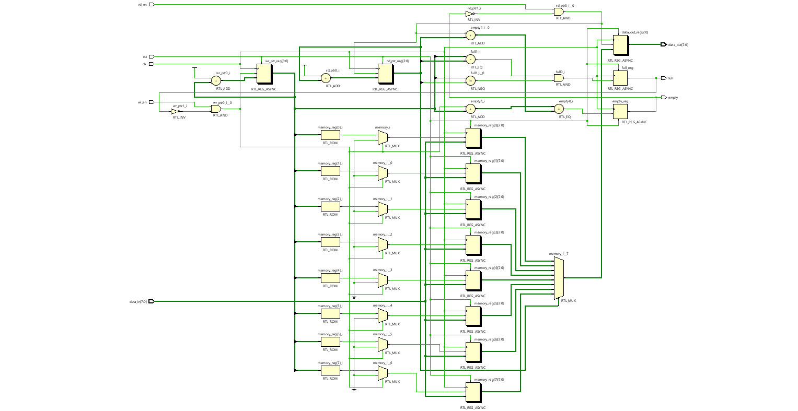
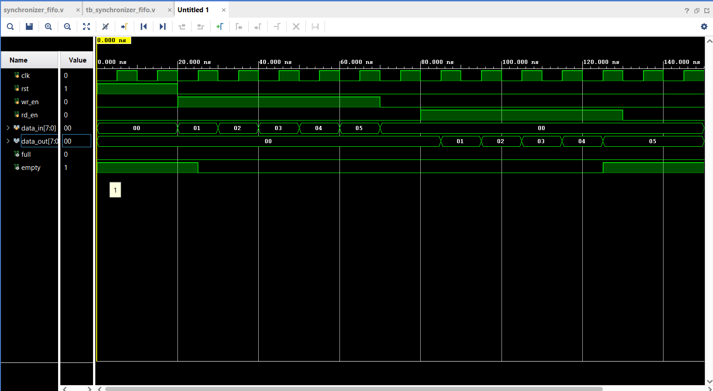

# Asynchronous FIFO Design Using Verilog HDL

<p align="center">
  <b>RTL Design | Clock Domain Crossing | FIFO Architecture | FPGA Design</b>
</p>

## 📌 Project Overview

This project implements an **Asynchronous FIFO (First-In First-Out) using Verilog HDL** to enable reliable data transfer between two independent clock domains.

Unlike synchronous FIFOs, an asynchronous FIFO operates with separate read and write clocks. Synchronization logic is used to safely transfer control information across clock domains and reduce the risk of metastability.

The design was developed and simulated using **Xilinx Vivado**.

## 🎯 Project Objectives

- Design an asynchronous FIFO using Verilog HDL.
- Understand FIFO architecture and data buffering.
- Implement independent read and write operations.
- Understand Clock Domain Crossing (CDC).
- Implement synchronization logic for reliable data transfer.
- Analyze RTL simulation waveforms.
- Verify FIFO read and write operations.

## ⚙️ Key Features

- Asynchronous FIFO architecture.
- Independent read and write clock domains.
- FIFO memory-based data storage.
- Read and write pointer management.
- Synchronizer-based clock domain crossing.
- FIFO full and empty condition handling.
- RTL simulation and waveform analysis.

## 🏗️ Design Architecture

The asynchronous FIFO consists of the following functional blocks:

1. **FIFO Memory:** Stores incoming data before it is read.
2. **Write Control:** Manages data insertion and write pointer updates.
3. **Read Control:** Manages data retrieval and read pointer updates.
4. **Synchronizer Logic:** Transfers control information safely between independent clock domains.
5. **Status Logic:** Manages FIFO full and empty conditions.

### Block Diagram


### RTL Schematic



## 🔄 Working Principle

1. The write clock controls incoming data storage.
2. Data is written into FIFO memory when a valid write operation is performed.
3. The read clock independently controls data retrieval.
4. Synchronization logic handles information crossing between clock domains.
5. Read and write control logic maintains FIFO operation.
6. FIFO status signals indicate whether data can be written or read.

## 🧪 Simulation and Verification

The design was simulated using **Xilinx Vivado Simulator (XSim)**.

Simulation waveforms were analyzed to observe the FIFO's behavior during read and write operations.

### Simulation Waveform



## 🛠️ Tools and Technologies

| Category | Technology |
|---|---|
| Hardware Description Language | Verilog HDL |
| FPGA Design Tool | Xilinx Vivado |
| Simulation | Vivado XSim |
| Design Approach | RTL Design |
| Core Concepts | FIFO, CDC, Synchronization |

## 📂 Repository Structure

```text
Synchronizer-FIFO-Using-Verilog-HDL/
│
├── Synchronizer FIFO Using Verilog HDL.srcs/
│   ├── sources_1/
│   └── sim_1/
│
├── Asynchronous FIFO Block Diagram.png
├── schematic.png
├── wavaform.png
│
├── Synchronizer FIFO Using Verilog HDL.xpr
└── README.md
```

## 🚀 How to Run the Project

1. Clone the repository:

```bash
git clone https://github.com/abhirammanikantareddymallidi/Synchronizer-FIFO-Using-Verilog-HDL.git
```

2. Open **Xilinx Vivado**.
3. Select **Open Project**.
4. Navigate to the cloned repository.
5. Open `Synchronizer FIFO Using Verilog HDL.xpr`.
6. Run **Run Simulation → Run Behavioral Simulation**.
7. Analyze the generated simulation waveforms.

## 📚 Key Learning Outcomes

- Understanding asynchronous FIFO architecture.
- Practical implementation of RTL using Verilog HDL.
- Understanding Clock Domain Crossing (CDC).
- Learning synchronization techniques.
- Analyzing digital design schematics.
- Functional verification using simulation waveforms.

## 👨‍💻 Author

**Abhiram Manikanta Reddy**

B.Tech – Electronics and Communication Engineering  
Specialization: VLSI Design

- GitHub: [@abhirammanikantareddymallidi](https://github.com/abhirammanikantareddymallidi)
- LinkedIn: [LinkedIn Profile](https://www.linkedin.com/in/mallidi-abhiram-manikanta-reddy/)

---

⭐ If you find this project useful, consider giving this repository a star.
